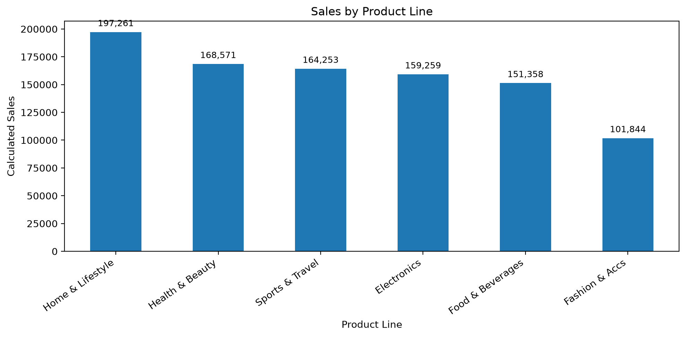
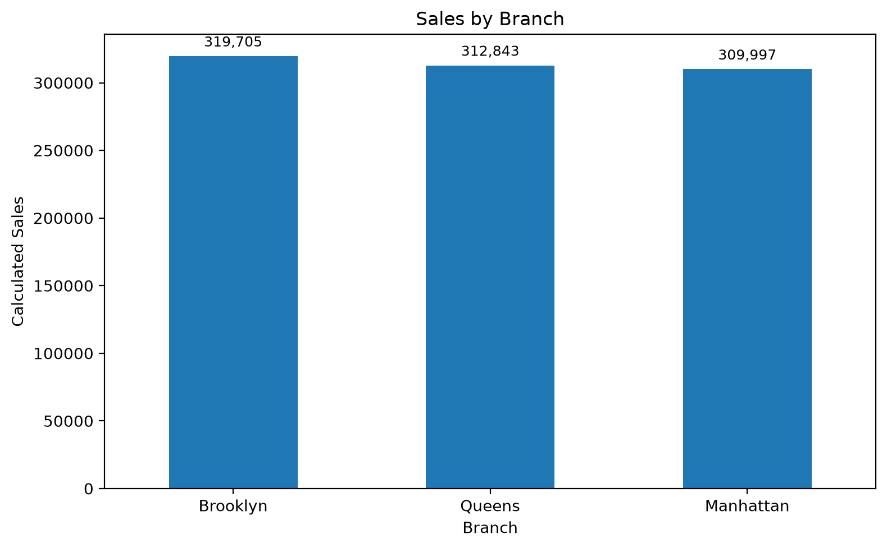
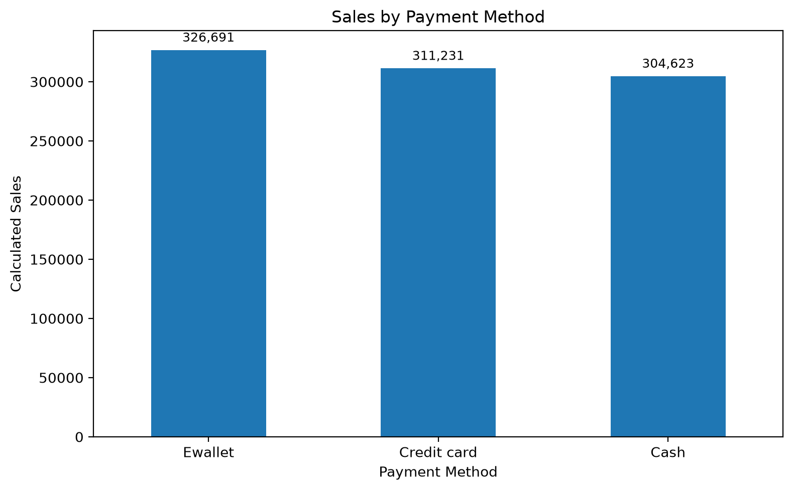
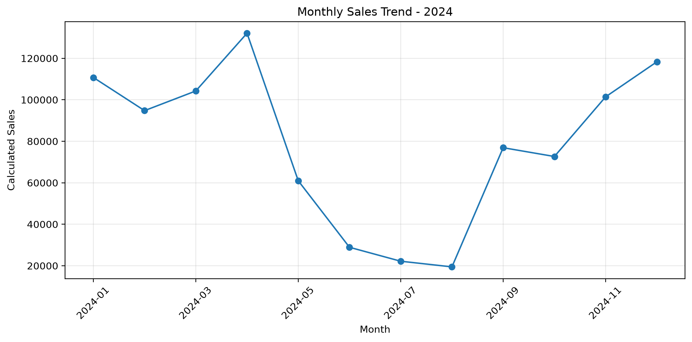

# Supermarket Sales Analysis

## Project overview
This beginner-level data analysis project explores a supermarket sales dataset using Python and Pandas. It checks basic data quality, calculates sales as `Unit price × Quantity`, compares performance by product line, branch, payment method, and month, and creates visualisations for business interpretation.

> **Important data note:** The sales metric in this project is calculated from unit price multiplied by quantity. The dataset does not provide a currency label in the columns shown, so results are presented without a currency symbol. These are sales amounts, not profit.

## Business questions
- What is the total calculated sales amount and number of units sold?
- Which product lines, branches, and payment methods have the highest calculated sales?
- How does calculated sales change over the months in 2024?
- What changed between April and May 2024?

## Tools used
- Python
- Pandas
- Matplotlib
- VS Code
- CSV data

## Project structure
```text
retail-sales-analytics/
├── data/
│   ├── raw/
│   └── processed/
│       └── supermarket_sales_cleaned.csv
├── outputs/
│   └── charts/
├── src/
│   └── inspect_data.py
├── requirements.txt
└── README.md
```

## Methodology
1. Loaded the CSV into a Pandas DataFrame.
2. Inspected rows, columns, data types, missing values, and exact duplicate rows.
3. Converted `Date` to a datetime type.
4. Checked invalid dates and non-positive unit prices and quantities.
5. Calculated row-level sales as `Unit price × Quantity`.
6. Aggregated calculated sales by product line, branch, payment method, and month.
7. Created bar charts and a monthly trend line chart.
8. Exported an analysis-ready CSV separately from the raw file.

## Key results
- Records analysed: **5,053**
- Columns in the source dataset: **9**
- Total units sold: **23,211**
- Total calculated sales: **942,544.85**
- Missing values detected in the initial check: **0**
- Exact duplicate rows detected in the initial check: **0**
- Invalid dates after conversion: **0**
- Non-positive unit prices: **0**
- Non-positive quantities: **0**

### Sales by product line
- Home & Lifestyle: 197,260.56
- Health & Beauty: 168,570.61
- Sports & Travel: 164,252.94
- Electronics: 159,259.10
- Food & Beverages: 151,357.73
- Fashion & Accs: 101,843.91

### Sales by branch
- Brooklyn: 319,705.48
- Queens: 312,842.82
- Manhattan: 309,996.55

### Sales by payment method
- Ewallet: 326,691.31
- Credit card: 311,230.89
- Cash: 304,622.65

## April–May comparison
- April calculated sales: **132,083.88**
- May calculated sales: **60,955.78**
- Change in calculated sales: **-53.9%**
- Change in record count: **-6.7%**
- Change in units sold: **-51.8%**
- Change in average units per record: **-48.3%**

Food & Beverages was the only product line in the provided April–May comparison whose calculated sales increased, from 28,238.65 in April to 30,740.29 in May. Other product lines declined in that comparison.

## Limitations
- `Sales` is a calculated metric (`Unit price × Quantity`), not a source-provided total.
- Currency is not explicitly labelled in the columns reviewed.
- No cost or expense data is available, so profit or profitability cannot be calculated.
- No unique order identifier is present in the columns reviewed; each row is therefore referred to as a **record**, not a verified unique order.
- Observed month-to-month changes are descriptive. The dataset alone does not establish why sales changed.
- Check the dataset's original licence and attribution requirements before publishing the raw data publicly.

## Visual Analysis

### Sales by Product Line


### Sales by Branch


### Sales by Payment Method


### Monthly Sales Trend


## How to run
From the project root, activate your virtual environment and install dependencies:
```powershell
python -m pip install pandas matplotlib
python src/inspect_data.py
```

## Next improvements
- Add automated data-quality checks and assertions.
- Add a concise PDF report with charts and findings.
- Improve chart formatting with value labels and consistent number formatting.
- Validate the source dataset's provenance and licence before public release.
